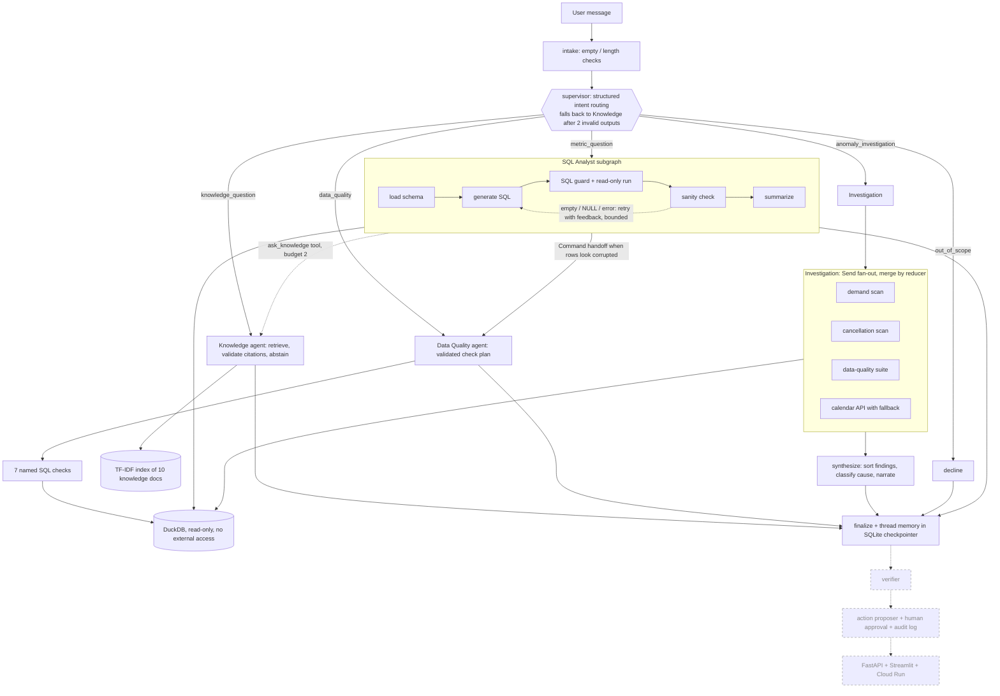

# RetailOps Analyst Agent

A multi-agent assistant for retail operations data, built with LangGraph and LangChain, instrumented for LangSmith, and backed by DuckDB. It answers metric questions with validated read-only SQL, answers definition and runbook questions with citations (or says it doesn't know), runs data-quality checks, and investigates anomalies by fanning out tool-driven workers in parallel. **All data is synthetic.**

**Honest status in one paragraph.** The data generator, SQL guard, retrieval, specialists, graph, evaluators and offline detectors are built and covered by 223 passing tests. The language-model parts (routing, SQL generation, narration) have only been exercised with scripted test doubles: no run with a real model has completed yet, so there are **no accuracy numbers for the agents, no E0 vs E1 comparison and no LangSmith traces yet**. What has been measured without a model is reported below with its limits. There is no public demo; it runs locally. Approvals, a verifier, an API and a UI are not built (see the roadmap).

## Architecture



Dashed boxes are **planned, not built**. Every specialist returns structured evidence (SQL and rows, findings, or cited chunk ids). Tool output and retrieved text are wrapped as untrusted data before a model sees them.

## Key design decision and tradeoff

**Supervisor plus specialists (E1) versus one ReAct agent holding every tool (E0).** Hypothesis: narrow specialists improve SQL accuracy and safety, and fan-out reduces investigation latency, at the cost of more tokens and orchestration complexity. Both systems are built and scored by the same code, with the same tools, guard, retriever and model for the SQL work (`evals/targets.py`, `evals/run_eval.py`).

- **Accuracy, groundedness, tokens: not yet measured.** Needs a real-model run (`make eval-full`). The table below is intentionally empty until then.
- **Latency of the parallel fan-out, tool part only: measured.** p50 0.71 s sequential vs 0.55 s parallel (1.29x), p95 0.86 s vs 0.61 s, over 10 repeats with model calls scripted out. The data-quality suite dominates, so the gain is modest.
- A deliberate design choice behind E1's investigation: workers are deterministic tools, not free-running model agents. That makes detection measurable without a model and removes the risk of a worker inventing a finding; the cost is less flexibility than ad hoc SQL.

## Evaluation results

Generated from recorded runs by `python -m evals.report` (`evals/reports/results.md`). A cell says "not yet measured" when no run exists.

| Experiment | What changed | SQL exec accuracy | Anomaly recall | Groundedness | Safety pass | p50 latency | Cost/req |
|---|---|---|---|---|---|---|---|
| E0 | Single agent, all tools | not yet measured | not yet measured | not yet measured | not yet measured | not yet measured | not computed |
| E1 | Supervisor + specialists | not yet measured | not yet measured | not yet measured | not yet measured | not yet measured | not computed |
| Detectors only (no model) | 7 DQ checks + 2 scanners | n/a | **7 / 7** (seed 42 and seeds 1-5) | n/a | n/a | 0.49 s per scan | n/a |

Dataset sizes: `sql_gold` 31 questions (10 easy, 13 medium, 8 hard; every 5th held out), `rag_gold` 36 (28 answerable, 8 not), `routing_smoke` 18 cases (3 with follow-ups), anomaly manifest 7 anomalies and 2 decoy windows. Real-model repeats: none yet. Cost per request is not computed because model prices have not been verified; token counts are recorded instead.

**Measured without a model**

*Anomaly detectors* (`python -m evals.run_detectors --sweep-seeds 1,2,3,4,5 --write-report`, source `evals/reports/anomaly_detectors.json`): every injected anomaly found with the right kind, scope and data-quality-vs-business class (7/7), all 8 findings explained by a real anomaly (precision 1.0), 0 false alarms in 2 decoy windows, and the same result on five other seeds with unchanged thresholds. The real demand drop is classified as a business change because no data-quality defect overlaps it. *Limits:* the data has a clean baseline and the thresholds were chosen knowing the injected magnitudes, so this shows the tools work on this generator, not on noisy production data; window edges are approximate (about 2 days); it scores the tools, not an agent's investigation.

*Retrieval* (`python -m evals.run_rag_retrieval --write-report`, source `evals/reports/rag_retrieval.json`; 47 chunks, TF-IDF, k=5, threshold 0.12):

| Split | hit@5 | MRR | Answered when answerable | Abstained when unanswerable |
|---|---|---|---|---|
| All (28 / 8) | 1.00 | 0.946 | 0.964 | 0.25 |
| Dev (21 / 6) | 1.00 | 0.952 | 0.952 | 0.33 |
| Held-out (7 / 2) | 1.00 | 0.929 | 1.00 | 0.00 |

*Limits:* the questions use the documents' own vocabulary and the sets are small, so hit@5 is optimistic. Relevance scores cannot separate unanswerable questions (up to 0.27) from answerable ones (down to 0.11), so retrieval-level abstention is weak. Abstention is therefore layered (threshold, the model's `answerable` flag, and citation validation); the model-dependent layers are not yet measured.

**How to reproduce, and how to get the missing numbers**

1. `copy .env.example .env` and set `ANTHROPIC_API_KEY` (and `LANGSMITH_*` for tracing). Confirm the three `MODEL_*` names are valid for your account; they are suggestions and have not been confirmed against the API.
2. `make data`, `make ingest`.
3. Cheap checks first: `uv run python -m evals.run_sql_gold --limit 3`, `uv run python -m evals.run_routing_smoke`.
4. `make eval-full` runs E0 and E1 three times each and writes `evals/reports/results.md`. Add `--langsmith` to the `run_eval` commands to sync the dataset and log experiments named `retailops-E#-<git sha>`.

## Safety design and limitations

Implemented and tested:

- **SQL guard** (`src/retailops/guards/sql_guard.py`, rules from `docs/05`): parser-based (sqlglot); exactly one statement; SELECT/WITH only; table allowlist from the catalog; no schema-qualified names, table functions or file sources; unknown functions rejected; comments stripped; the query is regenerated from the parsed tree and only that text is executed; LIMIT enforced.
- **Defence in depth:** the analytics connection is `read_only` with `enable_external_access=False` (tested: file reads fail even without the guard); row cap; timeout via interrupt; the audit database is a separate file.
- **Untrusted data:** tool output, SQL results, retrieved passages and the calendar API are wrapped in delimited blocks with delimiter-escape protection; injection fixtures are seeded in the data (4 `notes`, 1 product name) and tests check they stay data.
- **Bounded behaviour:** SQL retries (1 + 2), lookup budget (2), supervisor fallback after 2 invalid outputs, provider errors are not swallowed.
- **Secrets:** `.env` is gitignored; `.env.example` has placeholders only.

Not covered, or not yet verified:

- **No action tools exist yet**, so there is nothing to execute; human approval, the audit-log writer and the "no `execute_action` without approval" test belong to M6 and are not built.
- Injection resistance is tested with scripted models, so it shows that the plumbing treats data as data. **Resistance of a real model is not measured.**
- The guard is only as good as its parser; a dialect edge case could slip past it, and strict rules (unknown functions, qualified names) will reject some legitimate queries, which the retry loop must work around.
- No rate limiting, budget cap, verifier or cost tracking yet. CI is defined but has not run on GitHub. mypy covers only the config and guard modules.
- The knowledge documents were drafted by an AI assistant and are **pending the author's review**.

## Quickstart

Requires Python 3.12 via [uv](https://docs.astral.sh/uv/) and GNU Make (on Windows: `winget install astral-sh.uv ezwinports.make`).

```
make setup     # install pinned dependencies
make data      # generate the synthetic warehouse (deterministic, seed 42)
make test      # 223 tests, no API key needed (about 80 s)
```

Also: `make lint`, `make ingest` (build the knowledge index), `make eval-smoke` and `make eval-full` (need a key). `make dev`, `make docker-build` and `make docker-run` exit with "not implemented" until M7.

## Project structure

```
src/retailops/
  graph.py              top-level LangGraph app, routing, handoff, thread memory
  agents/               supervisor, sql_analyst, knowledge, data_quality, investigation
  tools/                sql (get_schema, run_sql), dq (7 checks), metrics (scanners),
                        calendar, retrieval, knowledge_tool (ask_knowledge), signals
  guards/               sql_guard, injection (spotlighting)
  rag/                  chunking, embeddings (tfidf; optional fastembed), retriever, ingest
  data/                 generate, load, schema, schema_catalog.yaml
  prompts/              versioned prompt files (versions go into trace metadata)
  models.py config.py observability.py state.py
knowledge/              10 markdown documents with front matter
evals/                  datasets/, evaluators/, targets.py (E0, E1), run_*.py, reports/
tests/                  unit/ and integration/ (223 tests)
docs/                   design docs 01-08, DECISIONS.md, 09-WORK-SAMPLE-WRITEUP.md
```

## What I personally built

See `docs/09-WORK-SAMPLE-WRITEUP.md`. This repository was built with an AI coding assistant (Claude Code) working under the author's direction. **The author must complete that section** with which parts they specified, reviewed, tested or redesigned; it is deliberately not filled in on their behalf.

## Roadmap (not built)

M6 verifier, action proposer, interrupt-based human approval, audit log and the unreachable-`execute_action` test; M7 FastAPI, streaming, Streamlit UI, Docker; M8 cloud deployment, budget cap, rate limiting; M9 real-model runs for E0/E1/E2/E3, ablations, model tiering, judge calibration with 30 hand labels, repeats with ranges; M10 debugging case studies from real traces. Also pending: a real-model check of routing, SQL generation and abstention; LangSmith traces; evaluating dense embeddings against the TF-IDF baseline; the 40-question `rag_gold`, `anomaly_gold`, `safety`, `trajectory` and `multi_turn` datasets from `docs/04`.

## Status table

| Feature | Status |
|---|---|
| Setup: layout, pinned deps (uv.lock), Makefile, ruff/mypy/pytest, CI definition | Done; CI **not yet run on GitHub** |
| Synthetic data generator, DuckDB warehouse, anomaly manifest, schema catalog | Done and verified (deterministic by fingerprint; each anomaly detectable by SQL) |
| SQL guard, `run_sql`, `get_schema` | Done and verified |
| Text-to-SQL subgraph with retry, lookups and handoff | Control flow verified with a scripted model; **not run with a real model** |
| Gold set (31 questions, gold SQL and results) and execution-accuracy evaluator | Done and verified (gold SQL reproduces from the seed) |
| Execution accuracy of the agents on gold questions | **Not yet measured** |
| Knowledge base (10 docs) | Drafted by AI; **pending author review** |
| Chunking, TF-IDF index, retriever, citation validation | Done and verified; retrieval measured (above) |
| Knowledge agent, supervisor, top-level graph, thread memory | Control flow verified with scripted models; not run with a real model |
| Routing accuracy on 18-case smoke set | **Not yet measured** |
| Dense embeddings (`--extra rag`) | Code written, **never run** |
| 7 data-quality checks and 2 metric scanners | Done and verified; scored against the manifest (above) |
| Data Quality agent, parallel investigation, calendar tool | Verified with scripted models / mocked transport; calendar schema confirmed by one live call |
| E0 and E1 targets, runner, report generator, LangSmith dataset sync | Built; plumbing verified; LangSmith `evaluate` path **never run** |
| E0 vs E1 results and failure analysis | **Not yet measured** |
| LangSmith traces | Metadata wired; **no trace produced yet** |
| Verifier, approvals, audit log, API, UI, deployment | **Not started** |

Decisions with alternatives and reasons: `docs/DECISIONS.md`.
