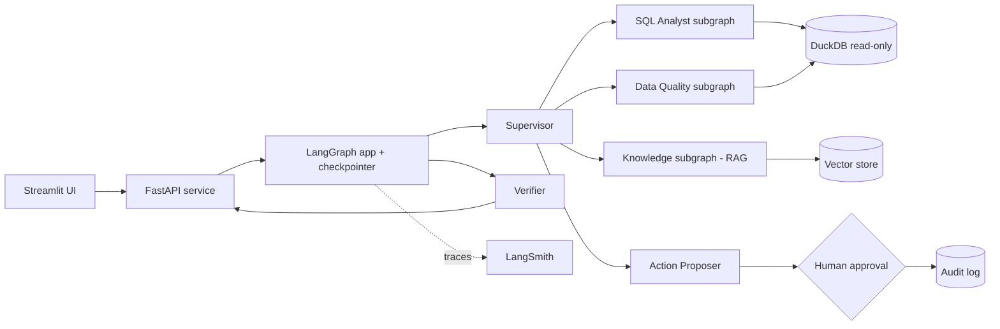

# 02 – Architecture

> Before writing code, Claude Code must verify current APIs in the official LangGraph, LangChain and LangSmith docs (and pin versions). Names below describe concepts; confirm exact function names and import paths against the installed versions.

## 1. System overview


## 2. Graph design
**Top-level state (`RetailOpsState`)**: `messages`, `intent`, `plan`, `findings` (list with a merge reducer), `evidence` (list), `proposed_actions`, `approval_status`, `final_answer`, `verification`, `budget` (token/step counters).

**Nodes**
1. `intake`: normalize the request, apply input guardrails (length, obvious abuse), load thread context.
2. `supervisor`: classify intent (`metric_question`, `anomaly_investigation`, `data_quality`, `knowledge_question`, `out_of_scope`) and produce a plan. Uses structured output (Pydantic) so routing is validated, not parsed from free text.
3. `sql_analyst` (subgraph): schema retrieval → SQL generation → validation (guard) → execution → result check → retry loop → summarize with evidence.
4. `data_quality` (subgraph): selects and runs check tools, returns structured findings with counts and sample IDs.
5. `knowledge` (subgraph): query rewrite → retrieve → grade relevance → answer with citations or abstain.
6. `parallel_investigation`: fan out with the `Send` API to `sql_analyst` (revenue slice), `sql_analyst` (cancellation slice) and `data_quality` at the same time; merge via reducer.
7. `synthesizer`: combine findings into one answer with evidence tables.
8. `action_proposer`: when findings justify it, propose actions (simulated tools).
9. `human_approval`: uses the interrupt mechanism to pause; resumes with approve/reject; requires a checkpointer.
10. `verifier`: check numbers and claims against tool outputs; loop back once for repair if ungrounded.
11. `finalize`: attach evidence, trace URL, confidence note.

**Coordination patterns (all three must be implemented and shown in traces):**
- *Supervisor routing:* `supervisor` decides which specialist runs.
- *Handoff:* a specialist can transfer control directly to another specialist using the graph's command/handoff mechanism, passing a structured reason and the relevant state (example: `sql_analyst` finds duplicate-looking rows and hands off to `data_quality`).
- *Agents-as-tools:* the Knowledge agent is wrapped as a tool (`ask_knowledge`) that the SQL Analyst can call for metric definitions without giving up control.
Confirm the exact mechanisms (command objects, handoff tools, supervisor helper libraries) in the current docs before choosing.

**Edges:** conditional routing from `supervisor`; fan-out/fan-in for investigations; `action_proposer` only reachable after findings exist; `human_approval` always precedes any action tool execution.

## 3. Tools (typed, with Pydantic schemas)
| Tool | Purpose | Safety |
|---|---|---|
| `get_schema(tables?)` | Return table/column descriptions from the catalog | Read-only |
| `run_sql(query)` | Execute validated SQL on DuckDB | Guard (Doc 05), read-only connection, row limit, timeout |
| `run_dq_check(check_name, params)` | Named checks: duplicates, nulls, late events, invalid sequences, schema drift | Parameter allowlist |
| `compare_periods(metric, a, b, group_by)` | Standard metric delta computation | Uses vetted SQL templates |
| `search_knowledge(query, k)` | Vector retrieval returning chunks with IDs | Returned text treated as untrusted data |
| `ask_knowledge(question)` | Knowledge agent wrapped as a tool (agents-as-tools) | Same untrusted-data handling; call budget |
| `get_calendar_context(date_range, region)` | Real external API: holidays/events that may explain demand shifts | Timeout, retry, cache, fallback; response treated as untrusted data; no secrets in URLs |
| `record_feedback(run_id, score, comment)` | Attach user feedback to the trace | Comment sanitized and length-limited |
| `propose_action(type, target, rationale)` | Create an action proposal | No side effects |
| `execute_action(proposal_id)` | Simulated side effect | Only callable after approval; audit-logged |

## 4. Memory
- Short-term: LangGraph checkpointer (SQLite locally, Postgres or SQLite volume in cloud) keyed by `thread_id`.
- Conversation trimming: summarize older turns when context exceeds a threshold.
- Optional long-term (Tier 3): store of user preferences (default region, preferred currency) using the LangGraph store interface.

## 5. Error handling
- Tool errors return structured error objects fed back to the agent; max retries per tool.
- Global step and token budget in state; exceeding it ends the run with a partial answer and an explicit note.
- Timeouts at tool and request level.
- Deterministic fallbacks: if the supervisor's structured output fails validation twice, route to a safe default (`knowledge` with an abstain-friendly prompt).

## 6. Model and provider strategy
- Provider-agnostic model factory driven by environment variables (`MODEL_SUPERVISOR`, `MODEL_SQL`, `MODEL_JUDGE`), so cheaper models can serve simple nodes.
- Temperature 0 for SQL and routing.
- Prompts live in versioned files under `src/retailops/prompts/`; prompt version recorded in trace metadata.

## 7. Observability
- LangSmith tracing enabled by environment variables; project names per environment (`retailops-dev`, `retailops-eval`, `retailops-prod`).
- Metadata on every run: `prompt_version`, `git_sha`, `model_ids`, `thread_id`, `scenario_id` (for evals).
- Tags for node type and specialist.
- Structured JSON logs with the trace ID for correlation.

## 8. Key design decision (document and measure this)
**Supervisor + specialists vs. one ReAct agent with every tool.**
- Hypothesis: specialists with narrow tools and prompts improve SQL accuracy and safety, and parallel fan-out cuts anomaly investigation latency, at the cost of more tokens and orchestration complexity.
- Measurement: run the same evaluation set against (a) baseline single-agent and (b) multi-agent; report accuracy, latency p50/p95, tokens and cost per request, and failure categories.
- Report results even if the baseline wins on some metrics. The honest tradeoff analysis is the point.

## 9. Repository layout
```
retailops/
  CLAUDE.md
  README.md
  pyproject.toml
  Makefile
  Dockerfile
  docker-compose.yml
  .env.example
  .github/workflows/ci.yml
  docs/                      # these documents
  data/                      # generated (gitignored) + knowledge docs
  knowledge/                 # markdown knowledge base
  src/retailops/
    config.py
    models.py                # model factory
    state.py
    graph.py                 # top-level graph
    agents/{supervisor,sql_analyst,data_quality,knowledge,synthesizer,verifier,actions}.py
    tools/{sql,dq,metrics,retrieval,actions}.py
    guards/{sql_guard,injection,budget}.py
    data/{generate,schema,load}.py
    rag/{ingest,retriever}.py
    prompts/
    api/{main,schemas}.py
    ui/app.py
  evals/
    datasets/{sql_gold,anomaly_gold,rag_gold,safety,trajectory}.jsonl
    evaluators/
    run_eval.py
    reports/
  tests/{unit,integration}/
```
